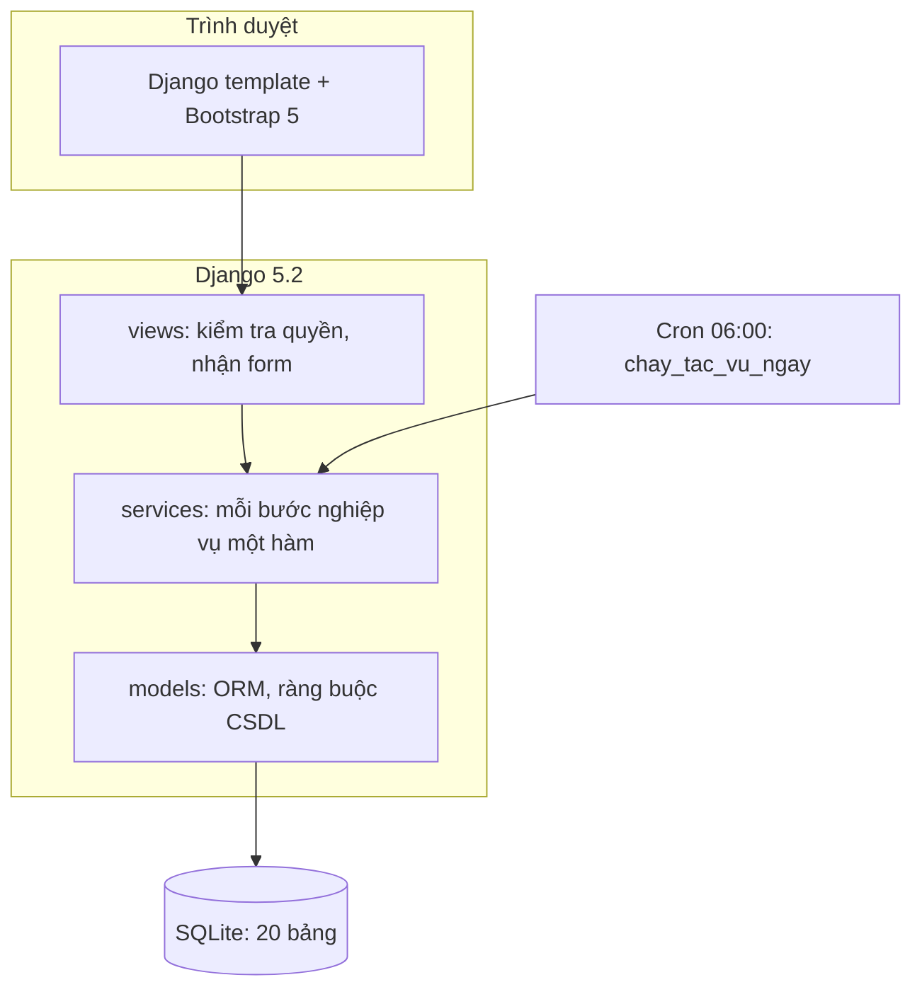
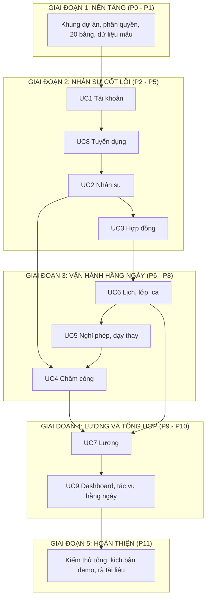

# HỆ THỐNG QUẢN LÝ NHÂN SỰ TRUNG TÂM TIẾNG HÀN (ICLS HRM)

[](https://www.python.org/)
[](https://www.djangoproject.com/)
[](https://getbootstrap.com/)
[](https://www.sqlite.org/)
[](ROADMAP.md)

---

> **Tài liệu đặc tả kỹ thuật, từ điển dữ liệu và lộ trình phát triển theo từng giai đoạn (Phase-by-Phase Roadmap) của hệ thống ICLS HRM.**  
> *Căn cứ theo đặc tả 38 use case, 20 bảng cơ sở dữ liệu trong [`ROADMAP.md`](ROADMAP.md) và thiết kế giao diện Figma.*

---

## 📌 I. THÔNG TIN CHUNG DỰ ÁN

* **Tên đề tài:** Hệ thống Quản lý Nhân sự Trung tâm tiếng Hàn (**ICLS HRM**)
* **Doanh nghiệp nghiên cứu:** Trung tâm tiếng Hàn **ICLS**, quy mô khoảng 40 nhân sự, 10 phòng học, 20 lớp
* **Bài toán:** thay thế việc quản lý nhân sự bằng giấy tờ, Excel và tin nhắn rời rạc; bao phủ toàn bộ vòng đời nhân sự từ tuyển dụng, onboarding, hợp đồng, phân công lớp và xếp ca, chấm công, nghỉ phép, dạy thay, tính lương đến thanh lý hợp đồng
* **Quy mô:** 10 app Django, 9 phân hệ, 38 use case, 4 vai trò, 20 bảng dữ liệu
* **Đội ngũ sinh viên thực hiện (Nhóm 4 thành viên):**
  1. **Huỳnh Ngọc Quế Châu (Trưởng nhóm):** Phụ trách **UC2** (Nhân sự, Onboarding), **UC6** (Lịch, lớp, ca, dạy thay).
  2. **Đặng Gia Huy:** Phụ trách **UC4** (Chấm công), **UC9** (Dashboard, tác vụ hằng ngày), **UC5** (Nghỉ phép).
  3. **Võ Ngọc Ngân Giao:** Phụ trách **UC1** (Tài khoản và phân quyền), **UC3** (Hợp đồng)
  4. **Trần Hoàng Yến Trang:** Phụ trách **UC7** (Lương), **UC8** (Tuyển dụng)

---

## 🛠️ II. KIẾN TRÚC CÔNG NGHỆ & DESIGN SYSTEM

### 1. Tech Stack

1. **Backend và xử lý nghiệp vụ:** Python 3.12+ với **Django 5.2 LTS**. View dạng hàm, mỗi bước nghiệp vụ là một hàm trong `services.py` có ghi mã use case; mỗi app chỉ ghi vào bảng của mình.
2. **Cơ sở dữ liệu:** **SQLite** (`db.sqlite3`), 20 bảng chia theo app, có `UniqueConstraint` và `CheckConstraint` ở mức CSDL.
3. **Giao diện (Template):** Django Template kế thừa `base.html` (menu trái theo vai trò, thanh tiêu đề, thẻ nội dung); **Bootstrap 5.3.3** và **Remix Icon 4.3.0** qua CDN; tùy biến màu thương hiệu trong `static/css/icls.css`.
4. **Tương tác phía trình duyệt:** JavaScript tối thiểu (`confirm()` cho thao tác xóa và khóa, `window.print()` cho phiếu lương). Không dùng framework JavaScript.
5. **Không dùng thư viện ngoài Django:** biểu đồ Dashboard vẽ bằng CSS (`conic-gradient`, thẻ `div`), lịch là bảng HTML, ảnh đại diện dùng `FileField` (không cần Pillow), email in ra terminal khi demo.



### 2. Bộ nhận diện thương hiệu (Figma file `KmBoh6wHMPfq9q99QgYpmA`)

* **Màu chủ đạo (Xanh ICLS):** `#004C08` (nút chính, tiêu đề) | hover `#003A06`
* **Màu nền khung:** `#B2C9B4` (xanh sage có lưới)
* **Màu điểm nhấn:** `#FFF1DF` (kem nhạt) | cảnh báo `#F08812` | nguy hiểm `#EE8C7F`
* **Màu chữ:** `#203627` | chữ phụ `#728078` | viền `#E5EBE6`
* **Typography:** tiêu đề dùng `Itim` và `Plus Jakarta Sans`; nội dung dùng `Quicksand`.

---

## 👥 III. CƠ CHẾ PHÂN QUYỀN NGƯỜI DÙNG (4 VAI TRÒ)

Hệ thống dùng Custom User Model kế thừa `AbstractUser` (đăng nhập bằng email), cột `role` quyết định vai trò. Decorator `@role_required` chặn sai vai trò và trả trang 403; dữ liệu "của mình" được lọc ngay trong truy vấn nên sửa ID trên URL cũng không lấy được dữ liệu người khác.

| Vai trò | Giá trị `role` | Quyền hạn và trách nhiệm nghiệp vụ |
| :--- | :--- | :--- |
| **1. Super Admin** | `SUPER_ADMIN` (không có hồ sơ nhân sự) | Quản lý tài khoản (thêm, đổi vai trò, khóa, mở khóa), xem nhật ký hoạt động, chạy tác vụ hằng ngày, duyệt giấy tờ, đơn nghỉ và giải trình **của Quản lý**; chỉ xem danh sách nhân sự, lịch, tổng hợp công và nghỉ phép. |
| **2. Quản lý** | `MANAGER` | Tuyển dụng, tiếp nhận nhân sự (Onboarding), hợp đồng, tạo lớp, xếp ca và xử lý dạy thay; duyệt giấy tờ, đơn nghỉ và giải trình **của Nhân viên và Kế toán**; xem tổng hợp công và nghỉ phép. |
| **3. Kế toán** | `ACCOUNTANT` | Cấu hình lương, lập, tính lại, chốt và phát hành bảng lương; xem bảng tổng hợp công; đồng thời là nhân sự bình thường (chấm công, xin nghỉ, xem phiếu lương của mình). |
| **4. Nhân viên** | `EMPLOYEE` | Chấm công, gửi giải trình, xin nghỉ, xem lịch, hồ sơ và phiếu lương của chính mình; nhân viên Part-time giữ chỗ vào khung ca do Quản lý mở. |

Quy tắc duyệt phân cấp: không ai tự duyệt yêu cầu của mình; yêu cầu của Quản lý chỉ Super Admin duyệt; yêu cầu của Nhân viên và Kế toán do Quản lý duyệt.

---

## 📋 IV. TỔNG HỢP 9 PHÂN HỆ NGHIỆP VỤ (UC1 ĐẾN UC9)

| Mã | Tên phân hệ | Số UC | Phụ trách | Tác nhân chính | Tóm tắt nghiệp vụ cốt lõi | Bảng CSDL trọng tâm |
| :---: | :--- | :---: | :---: | :--- | :--- | :--- |
| **UC1** | **Xác thực và quản lý tài khoản (`accounts`)** | 6 | **Ngân Giao** | Mọi vai trò, Super Admin | Đăng nhập, quên và đổi mật khẩu bằng link có thời hạn, tài khoản cá nhân, Super Admin quản lý tài khoản (thêm, đổi vai trò, khóa và mở khóa, không xóa cứng), đăng xuất. | `users`, `activity_logs` |
| **UC2** | **Quản lý nhân sự (`employees`)** | 6 | **Quế Châu** | Quản lý, Kế toán, Nhân viên | Danh sách và hồ sơ nhân sự, Onboarding từ ứng viên (tạo tài khoản, quỹ phép), tải và duyệt giấy tờ chứng chỉ, cảnh báo hết hạn. | `employees`, `employee_documents` |
| **UC3** | **Quản lý hợp đồng (`contracts`)** | 5 | **Ngân Giao** | Quản lý, Kế toán, Nhân viên | Tạo, tra cứu, gia hạn, thanh lý hợp đồng. Thanh lý chạy trong một giao dịch: khóa tài khoản, kết thúc phân công lớp, tạo yêu cầu dạy thay, trả ca Part-time, đóng cấu hình lương. | `contracts` |
| **UC4** | **Quản lý chấm công (`attendance`)** | 5 | **Gia Huy** | Quản lý, Kế toán, Nhân viên | Check-in, Check-out theo ca (trễ quá 5 phút, về sớm tự ghi), giải trình, duyệt giải trình, lịch sử và bảng tổng hợp công (ngày công Full-time, giờ công Part-time). | `attendance` |
| **UC5** | **Quản lý nghỉ phép (`leave`)** | 4 | **Gia Huy** | Quản lý, Kế toán, Nhân viên | Gửi đơn (tự tính số ngày, kiểm tra quỹ phép), duyệt đơn (trừ quỹ phép, tạo yêu cầu dạy thay), quỹ phép cá nhân, tổng hợp nghỉ phép. | `leave_requests`, `leave_balances` |
| **UC6** | **Lịch làm việc và phân công (`schedule`)** | 4 | **Quế Châu** | Quản lý, Nhân viên | Tạo lớp và sinh buổi dạy (gợi ý giáo viên rảnh và có ca bao trọn giờ học), xem lịch, khung ca Part-time (giữ chỗ an toàn khi nhiều người bấm cùng lúc), xử lý dạy thay. | `classes`, `class_assignments`, `teaching_sessions`, `shift_assignments`, `substitute_requests` |
| **UC7** | **Quản lý lương (`payroll`)** | 3 | **Yến Trang** | Kế toán, Quản lý, Nhân viên | Cấu hình lương theo thời gian, lập bảng lương (dòng tự động, thuế TNCN tự tính, thưởng và điều chỉnh), chốt, phát hành, phiếu lương cá nhân In hoặc Lưu PDF. | `salary_configs`, `payrolls`, `payroll_details` |
| **UC8** | **Tuyển dụng (`recruitment`)** | 3 | **Yến Trang** | Quản lý | Đợt tuyển dụng, hồ sơ ứng viên, xếp lịch phỏng vấn và dạy thử (kiểm tra trùng lịch), chấm điểm 0 đến 10, chuyển Onboarding khi đạt. | `recruitment_campaigns`, `candidates`, `recruitment_rounds` |
| **UC9** | **Dashboard và tác vụ hằng ngày (`dashboard`)** | 2 | **Gia Huy** | Mọi vai trò, Hệ thống, Super Admin | Dashboard riêng cho 4 vai trò (mỗi thẻ có link tới trang xử lý); tác vụ hằng ngày 5 bước (hết hạn và nhắc giấy tờ, nhắc hợp đồng, vắng mặt và quên check-out, trạng thái lớp và buổi dạy, quỹ phép năm), chạy lại không trùng. | Đọc các bảng khác, ghi `activity_logs` |

---

## 🗺️ V. LỘ TRÌNH THỰC HIỆN TỪNG PHASE (PHASE-BY-PHASE ROADMAP)

Hệ thống được triển khai tuần tự qua **5 giai đoạn**, bám sát vòng đời của một nhân sự trong trung tâm. Từ P3, mỗi phase làm trọn một module gồm giao diện và Python (services, forms, views, tests).



### GIAI ĐOẠN 1 (P0 - P1): NỀN TẢNG DỰ ÁN & CƠ SỞ DỮ LIỆU

> **Mục tiêu:** Dựng khung dự án, phân quyền dùng chung và toàn bộ 20 bảng để mọi app sau này tham chiếu được nhau mà không phải sửa migration.

* **Phụ trách:** Ngân Giao (khung dự án, phân quyền), cả nhóm viết models của app mình phụ trách
* **Nội dung:** Khởi tạo 10 app và `settings.py` (tham số nghiệp vụ), `base.html` theo Figma với menu theo vai trò, `role_required`, `co_quyen_duyet`, thông báo, nhật ký, 20 models và migration, lệnh `tao_du_lieu_mau` (40 nhân sự, 20 lớp)

**Tiêu chuẩn nghiệm thu:**
* `python manage.py check` đạt 0 lỗi; `makemigrations --check` không có thay đổi.
* Chạy `tao_du_lieu_mau` nhiều lần không nhân đôi dữ liệu.

### GIAI ĐOẠN 2 (P2 - P5): NHÂN SỰ CỐT LÕI

> **Mục tiêu:** Hoàn thiện xác thực, tuyển dụng, hồ sơ nhân sự và hợp đồng: từ ứng viên thành nhân sự đang làm việc.

* **Phụ trách:** UC1 (Ngân Giao: 1.1, 1.5, 1.6; Yến Trang: 1.2 - 1.4), UC8 (Yến Trang), UC2 (Quế Châu), UC3 (Ngân Giao)
* **Nội dung:** Đăng nhập và quản lý tài khoản; đợt tuyển dụng, phỏng vấn, dạy thử, đánh giá; Onboarding, giấy tờ và cảnh báo hết hạn; tạo, gia hạn, thanh lý hợp đồng

**Tiêu chuẩn nghiệm thu:**
* Đăng nhập được với cả 4 vai trò; tài khoản bị khóa không đăng nhập được.
* Luồng tuyển dụng đến hợp đồng: ứng viên đạt, tạo hồ sơ (HIRED), tạo hợp đồng đầu tiên thì nhân sự chuyển ACTIVE.
* Thanh lý hợp đồng khóa tài khoản và giải phóng lịch tương lai.

### GIAI ĐOẠN 3 (P6 - P8): VẬN HÀNH HẰNG NGÀY

> **Mục tiêu:** Vận hành lịch dạy, ca làm, nghỉ phép và chấm công, các phân hệ liên thông nhau.

* **Phụ trách:** UC6 (Quế Châu), UC5 (Ngân Giao: 5.1 - 5.2; Gia Huy: 5.3 - 5.4), UC4 (Gia Huy)
* **Nội dung:** Tạo lớp và sinh buổi dạy, lịch làm việc và lịch lớp, khung ca Part-time; gửi và duyệt đơn nghỉ, quỹ phép, dạy thay; check-in và check-out, giải trình, tổng hợp công

**Tiêu chuẩn nghiệm thu:**
* Tạo lớp chỉ gợi ý giáo viên có ca bao trọn giờ học; hai người cùng giữ chỗ cuối cùng thì chỉ một người được.
* Duyệt đơn nghỉ tự trừ quỹ phép và tạo yêu cầu dạy thay.
* Giải trình được chấp thuận thì bản ghi chuyển ON_TIME và được tính công.

### GIAI ĐOẠN 4 (P9 - P10): LƯƠNG & TỔNG HỢP

> **Mục tiêu:** Khép kín dòng tiền lương và cung cấp bức tranh tổng quan theo từng vai trò.

* **Phụ trách:** UC7 (Yến Trang), UC9 (Gia Huy)
* **Nội dung:** Cấu hình lương, lập, tính lại, chốt, phát hành bảng lương, thuế TNCN tự tính, phiếu lương In hoặc Lưu PDF; Dashboard 4 vai trò, tác vụ hằng ngày (nút và lệnh)

**Tiêu chuẩn nghiệm thu:**
* Số công, giờ công, lương khớp với số tính tay trong test; chốt lương khóa dữ liệu chấm công và nghỉ phép của tháng.
* Tác vụ hằng ngày chạy lại không tạo dữ liệu trùng; một bước lỗi các bước còn lại vẫn chạy.

### GIAI ĐOẠN 5 (P11): HOÀN THIỆN & KIỂM THỬ TỔNG

> **Mục tiêu:** Kiểm thử khép kín toàn hệ thống và chuẩn bị bảo vệ.

* **Phụ trách:** Cả nhóm; Quế Châu (Trưởng nhóm) tích hợp, Gia Huy kiểm thử tổng và kịch bản demo
* **Nội dung:** Chạy toàn bộ test, đối chiếu ma trận truy vết 38 use case, chạy kịch bản demo (tuyển dụng, Onboarding, phân công, vận hành, lương, thanh lý), rà tài liệu `GIAI_THICH.md`

**Tiêu chuẩn nghiệm thu:**
* 542 test đều qua; mỗi luồng của 38 use case có test đặt tên theo mã luồng.
* Kịch bản demo chạy trọn vẹn 43 bước; không app nào ghi chéo bảng của app khác.

---

## ⚙️ VI. VÒNG ĐỜI TRẠNG THÁI (STATE MACHINE)

Mỗi lần chuyển trạng thái do **đúng một hàm service** thực hiện và kiểm tra trạng thái hiện tại trước khi chuyển:

| Bảng CSDL | Cột trạng thái | Tập giá trị | Điều kiện chuyển trạng thái | UC |
| :--- | :--- | :--- | :--- | :---: |
| `employees` | `status` | `ONBOARDING`, `ACTIVE`, `RESIGNED`, `TERMINATED` | Tạo hợp đồng đầu tiên: ONBOARDING sang ACTIVE; thanh lý hợp đồng: ACTIVE sang RESIGNED hoặc TERMINATED | 3.1, 3.4 |
| `users` | `is_active` | `True`, `False` | Super Admin khóa hoặc mở khóa; thanh lý hợp đồng tự khóa. **Không xóa cứng tài khoản** | 1.5, 3.4 |
| `contracts` | `status` | `ACTIVE`, `EXPIRED`, `TERMINATED` | Gia hạn: hợp đồng cũ sang EXPIRED; thanh lý: sang TERMINATED. Mỗi nhân sự chỉ một hợp đồng ACTIVE | 3.3, 3.4 |
| `employee_documents` | `status` | `PENDING`, `APPROVED`, `REJECTED`, `EXPIRED` | Tải giấy tờ: PENDING; duyệt hoặc từ chối; quá ngày hết hạn: APPROVED sang EXPIRED (tác vụ hằng ngày) | 2.2, 2.6, 9.2 |
| `candidates` | `status` | `NEW`, `SCREENING`, `INTERVIEWING`, `TEACHING_TRIAL`, `PASSED`, `REJECTED`, `HIRED` | Sơ tuyển; xếp lịch phỏng vấn; giáo viên Full-time đạt phỏng vấn thì sang TEACHING_TRIAL, vị trí khác sang PASSED; tạo hồ sơ nhân sự: HIRED | 8.1 - 8.3, 2.5 |
| `recruitment_rounds` | `status` | `SCHEDULED`, `COMPLETED`, `CANCELLED` | Nhập kết quả: COMPLETED; hủy lịch hoặc ứng viên vắng: CANCELLED | 8.2, 8.3 |
| `classes` | `status` | `UPCOMING`, `ACTIVE`, `COMPLETED`, `CANCELLED` | Tới ngày bắt đầu: ACTIVE; quá ngày kết thúc: COMPLETED (tác vụ hằng ngày); Quản lý hủy lớp: CANCELLED | 6.1, 9.2 |
| `teaching_sessions` | `status` | `SCHEDULED`, `COMPLETED`, `CANCELLED` | Buổi dạy đã qua: COMPLETED; hủy buổi (không có người thay) hoặc hủy lớp: CANCELLED | 6.1, 6.4, 9.2 |
| `shift_assignments` | `status` | `OPEN`, `PENDING`, `SCHEDULED`, `CANCELLED` | Giữ chỗ: OPEN sang PENDING (cập nhật có điều kiện); hủy giữ chỗ: về OPEN; Quản lý chốt ca: SCHEDULED | 6.3, 3.4 |
| `substitute_requests` | `status` | `SEARCHING`, `COMPLETED`, `FAILED` | Duyệt đơn nghỉ hoặc thanh lý hợp đồng: SEARCHING; chốt người thay: COMPLETED; hủy buổi hoặc quá hạn: FAILED | 5.2, 6.4, 9.2 |
| `attendance` | `attendance_status` | `ON_TIME`, `LATE`, `EARLY_LEAVE`, `ABSENT`, `MISSING_CHECKOUT` | Check-in: ON_TIME hoặc LATE (quá 5 phút); check-out sớm: EARLY_LEAVE; không chấm công hoặc quên check-out: ABSENT, MISSING_CHECKOUT (tác vụ hằng ngày); giải trình được chấp thuận: ON_TIME | 4.1, 4.4, 9.2 |
| `attendance` | `explanation_status` | `NONE`, `PENDING`, `APPROVED`, `REJECTED` | Gửi giải trình: PENDING; duyệt hoặc từ chối. Chặn khi bảng lương tháng đã chốt | 4.2, 4.4 |
| `leave_requests` | `status` | `PENDING`, `APPROVED`, `REJECTED`, `CANCELLED` | Gửi đơn: PENDING; nhân sự hủy: CANCELLED; duyệt hoặc từ chối (từ chối bắt buộc lý do) | 5.1, 5.2 |
| `payrolls` | `status` | `DRAFT`, `LOCKED`, `SENT` | Khởi tạo: DRAFT; Chốt: LOCKED (không để thực nhận âm); Phát hành: SENT. **Chốt lương khóa chấm công, nghỉ phép và cấu hình lương của tháng đó** | 7.2 |

---

## 📊 VII. MA TRẬN PHÂN CHIA NHIỆM VỤ 38 USE CASES (4 THÀNH VIÊN)

<details>
<summary><b>Nhấn vào đây để xem toàn bộ danh sách 38 Use Cases phân chia cho 4 thành viên</b></summary>

| STT | Phân hệ | Mã UC | Tên Use Case | Phụ trách | Màn hình giao diện | Hàm service chính | Bảng CSDL liên quan | Test |
| :---: | :---: | :---: | :--- | :---: | :--- | :--- | :--- | :---: |
| 1 | UC1 | UC-1.1 | Đăng nhập | **Ngân Giao** | Form đăng nhập | `dang_nhap` | users, activity_logs | 9 |
| 2 | UC1 | UC-1.2 | Quên mật khẩu | **Ngân Giao** | Trang quên mật khẩu, trang đặt mật khẩu mới | `yeu_cau_dat_lai_mat_khau`, `tim_nguoi_dung_theo_link`, `dat_lai_mat_khau` | users | 8 |
| 3 | UC1 | UC-1.3 | Đổi mật khẩu | **Ngân Giao** | Form đổi mật khẩu | `doi_mat_khau` | users | 6 |
| 4 | UC1 | UC-1.4 | Xem & cập nhật tài khoản cá nhân | **Ngân Giao** | Trang tài khoản cá nhân (ảnh đại diện) | `cap_nhat_tai_khoan`, `dong_bo_tu_ho_so` | users, employees | 8 |
| 5 | UC1 | UC-1.5 | Quản lý tài khoản người dùng | **Ngân Giao** | Bảng quản lý tài khoản, form thêm tài khoản | `danh_sach_tai_khoan`, `tao_tai_khoan`, `doi_vai_tro`, `khoa_tai_khoan`, `mo_khoa_tai_khoan` | users, activity_logs | 10 |
| 6 | UC1 | UC-1.6 | Đăng xuất | **Ngân Giao** | Nút Đăng xuất trong menu tài khoản | `dang_xuat` | users, activity_logs | 3 |
| 7 | UC2 | UC-2.1 | Xem danh sách nhân sự | **Quế Châu** | Bảng danh sách nhân sự có tìm kiếm và lọc | `danh_sach_nhan_su`, `dem_nhan_su_theo_trang_thai` | employees | 10 |
| 8 | UC2 | UC-2.2 | Cập nhật hồ sơ cá nhân | **Quế Châu** | Form cập nhật hồ sơ và tải giấy tờ | `luu_ho_so_ca_nhan`, `tai_ban_moi_giay_to` | employees, employee_documents | 11 |
| 9 | UC2 | UC-2.3 | Xem hồ sơ cá nhân | **Quế Châu** | Hồ sơ của tôi, hồ sơ chi tiết nhân sự | `du_lieu_ho_so` | employees, employee_documents, contracts, leave_balances | 5 |
| 10 | UC2 | UC-2.4 | Theo dõi cảnh báo giấy tờ sắp hết hạn | **Quế Châu** | Trang cảnh báo giấy tờ sắp hết hạn | `danh_sach_canh_bao`, `muc_canh_bao`, `nhac_nho_cap_nhat` | employee_documents, notifications | 6 |
| 11 | UC2 | UC-2.5 | Tiếp nhận & quản lý hồ sơ nhân sự (Onboarding) | **Quế Châu** | Form tạo hồ sơ nhân sự (Onboarding) | `tao_ho_so_nhan_su`, `sua_ho_so_nhan_su` | employees, users, candidates, leave_balances | 14 |
| 12 | UC2 | UC-2.6 | Duyệt giấy tờ, chứng chỉ | **Quế Châu** | Danh sách giấy tờ chờ duyệt, trang duyệt hoặc từ chối | `giay_to_cho_duyet`, `duyet_giay_to`, `tu_choi_giay_to` | employee_documents, notifications | 9 |
| 13 | UC3 | UC-3.1 | Quản lý danh sách hợp đồng | **Ngân Giao** | Danh sách hợp đồng, form thêm hợp đồng | `danh_sach_hop_dong`, `them_hop_dong` | contracts, employees | 11 |
| 14 | UC3 | UC-3.2 | Tra cứu chi tiết hợp đồng | **Ngân Giao** | Trang chi tiết hợp đồng | `co_quyen_xem_hop_dong`, `lich_su_gia_han` | contracts | 7 |
| 15 | UC3 | UC-3.3 | Cập nhật & gia hạn hợp đồng | **Ngân Giao** | Form gia hạn, cập nhật file scan | `gia_han_hop_dong`, `cap_nhat_file_scan` | contracts | 8 |
| 16 | UC3 | UC-3.4 | Thanh lý hợp đồng | **Ngân Giao** | Form thanh lý hợp đồng | `thanh_ly_hop_dong` | contracts, employees, users, class_assignments, teaching_sessions, substitute_requests, shift_assignments, salary_configs | 14 |
| 17 | UC3 | UC-3.5 | Theo dõi hợp đồng sắp hết hạn | **Ngân Giao** | Trang hợp đồng sắp hết hạn (3 nhóm) | `hop_dong_sap_het_han` | contracts, notifications | 7 |
| 18 | UC4 | UC-4.1 | Chấm công Check-in / Check-out | **Gia Huy** | Màn hình chấm công, nút Check-in và Check-out | `man_hinh_cham_cong`, `check_in`, `check_out`, `lich_du_kien` | attendance, shift_assignments | 11 |
| 19 | UC4 | UC-4.2 | Gửi giải trình chấm công | **Gia Huy** | Form gửi giải trình | `gui_giai_trinh`, `kiem_tra_co_the_giai_trinh` | attendance | 5 |
| 20 | UC4 | UC-4.3 | Xem lịch sử chấm công cá nhân | **Gia Huy** | Lịch sử chấm công theo tháng | `lich_su_cham_cong`, `tong_thoi_gian_lam` | attendance | 4 |
| 21 | UC4 | UC-4.4 | Duyệt giải trình chấm công | **Gia Huy** | Danh sách và chi tiết giải trình chờ duyệt | `chap_thuan_giai_trinh`, `tu_choi_giai_trinh`, `danh_sach_giai_trinh` | attendance, notifications | 5 |
| 22 | UC4 | UC-4.5 | Quản lý bảng tổng hợp công | **Gia Huy** | Bảng tổng hợp công, chi tiết từng nhân sự | `tong_hop_cong`, `tinh_ngay_cong`, `tinh_gio_cong` | attendance, leave_requests | 5 |
| 23 | UC5 | UC-5.1 | Gửi đơn xin nghỉ phép | **Gia Huy** | Form gửi đơn nghỉ | `gui_don_nghi`, `tinh_so_ngay_nghi`, `huy_don_nghi` | leave_requests, leave_balances | 14 |
| 24 | UC5 | UC-5.2 | Duyệt đơn xin nghỉ phép | **Gia Huy** | Danh sách đơn chờ duyệt, trang quyết định | `duyet_don_nghi`, `tu_choi_don_nghi`, `tom_tat_anh_huong` | leave_requests, leave_balances, substitute_requests | 12 |
| 25 | UC5 | UC-5.3 | Tra cứu quỹ phép cá nhân | **Gia Huy** | Trang Nghỉ phép của tôi (quỹ phép) | `thong_tin_quy_phep`, `don_cua_nhan_su` | leave_balances, leave_requests | 4 |
| 26 | UC5 | UC-5.4 | Tổng hợp lịch sử nghỉ phép | **Gia Huy** | Bảng tổng hợp nghỉ phép | `tong_hop_nghi_phep` | leave_requests, leave_balances | 6 |
| 27 | UC6 | UC-6.1 | Tạo và phân công lớp học | **Quế Châu** | Form tạo lớp hai bước, trang chi tiết lớp | `goi_y_giao_vien`, `tao_lop_va_phan_cong`, `huy_lop` | classes, class_assignments, teaching_sessions | 14 |
| 28 | UC6 | UC-6.2 | Xem lịch làm việc & lịch lớp học | **Quế Châu** | Lịch làm việc, lịch lớp học, lịch cá nhân | `lich_lam_viec`, `lich_lop_hoc`, `lich_ca_full_time` | classes, teaching_sessions, shift_assignments, leave_requests | 9 |
| 29 | UC6 | UC-6.3 | Đăng ký & phân công ca làm việc Part-time | **Quế Châu** | Tạo khung ca, đăng ký ca, tổng hợp và chốt ca | `tao_khung_ca`, `giu_cho_ca`, `chot_khung_ca` | shift_assignments | 16 |
| 30 | UC6 | UC-6.4 | Xử lý dạy thay | **Quế Châu** | Danh sách và chốt dạy thay, thêm buổi học bù | `chot_day_thay`, `huy_buoi_hoc`, `them_buoi_hoc_bu` | substitute_requests, teaching_sessions | 13 |
| 31 | UC7 | UC-7.1 | Quản lý cấu hình lương | **Yến Trang** | Danh sách và chi tiết cấu hình lương | `luu_cau_hinh_luong`, `cau_hinh_hieu_luc` | salary_configs | 7 |
| 32 | UC7 | UC-7.2 | Lập và chốt bảng lương | **Yến Trang** | Danh sách bảng lương, bảng lương tháng, chi tiết từng người | `khoi_tao_bang_luong`, `tinh_lai_bang_luong`, `chot_bang_luong`, `phat_hanh_phieu_luong`, `tinh_thue_tncn` | payrolls, payroll_details | 16 |
| 33 | UC7 | UC-7.3 | Tra cứu phiếu lương cá nhân | **Yến Trang** | Phiếu lương của tôi (In / Lưu PDF) | `phieu_luong_da_phat_hanh`, `chi_tiet_phieu` | payrolls, payroll_details | 4 |
| 34 | UC8 | UC-8.1 | Quản lý đợt tuyển dụng & hồ sơ ứng viên | **Yến Trang** | Bảng ứng viên theo trạng thái, form đợt tuyển dụng | `tao_dot_tuyen_dung`, `them_ung_vien`, `danh_gia_so_tuyen`, `bang_ung_vien` | recruitment_campaigns, candidates | 12 |
| 35 | UC8 | UC-8.2 | Quản lý lịch phỏng vấn & dạy thử | **Yến Trang** | Ngăn hồ sơ ứng viên, xếp lịch phỏng vấn và dạy thử | `xep_lich_phong_van`, `xep_lich_demo`, `sua_lich_vong`, `huy_vong` | recruitment_rounds, candidates | 14 |
| 36 | UC8 | UC-8.3 | Đánh giá kết quả & chuyển Onboarding | **Yến Trang** | Danh sách vòng cần đánh giá, form chấm điểm | `vong_can_danh_gia`, `danh_gia_vong`, `danh_dau_da_tuyen` | recruitment_rounds, candidates | 14 |
| 37 | UC9 | UC-9.1 | Xem Dashboard theo vai trò | **Gia Huy** | Dashboard theo 4 vai trò | `du_lieu_dashboard`, `du_lieu_quan_ly`, `du_lieu_ke_toan`, `du_lieu_ca_nhan` | Đọc dữ liệu các bảng khác | 13 |
| 38 | UC9 | UC-9.2 | Chạy tác vụ tự động hằng ngày | **Gia Huy** | Nút "Chạy tác vụ hằng ngày" (Super Admin), lệnh dòng lệnh | `chay_tac_vu_ngay` | employee_documents, attendance, classes, teaching_sessions, substitute_requests, leave_balances, activity_logs | 10 |

</details>

Tổng: Quế Châu 10 UC, Gia Huy 9 UC, Ngân Giao 10 UC, Yến Trang 9 UC.

---

## 🔌 VIII. BẢN ĐỒ ĐƯỜNG DẪN (URL) TIÊU BIỂU

Hệ thống render HTML phía server (Django Template), không có REST API riêng. Các thao tác ghi dùng `POST` kèm CSRF token; trang trả về dạng HTML, lỗi nghiệp vụ hiện bằng thông báo nguyên văn theo đặc tả, sai vai trò trả trang 403.

<details>
<summary><b>Nhấn vào đây để xem 20 đường dẫn tiêu biểu</b></summary>

| STT | Mã UC | Method | URL | Quyền truy cập |
| :---: | :---: | :---: | :--- | :--- |
| 1 | UC-1.1 | **POST** | `/tai-khoan/dang-nhap/` | Công khai |
| 2 | UC-1.5 | **POST** | `/tai-khoan/quan-ly/{id}/khoa-mo-khoa/` | Super Admin |
| 3 | UC-2.1 | **GET** | `/nhan-su/` | Mọi vai trò (Nhân viên chỉ xem thông tin cơ bản) |
| 4 | UC-2.5 | **POST** | `/nhan-su/moi/` | Quản lý |
| 5 | UC-2.6 | **POST** | `/nhan-su/giay-to/{id}/` | Quản lý; Super Admin (giấy tờ của Quản lý) |
| 6 | UC-3.1 | **POST** | `/hop-dong/moi/` | Quản lý |
| 7 | UC-3.4 | **POST** | `/hop-dong/{id}/thanh-ly/` | Quản lý |
| 8 | UC-4.1 | **POST** | `/cham-cong/check-in/` | Quản lý, Kế toán, Nhân viên |
| 9 | UC-4.4 | **POST** | `/cham-cong/duyet/{id}/xu-ly/` | Quản lý; Super Admin (giải trình của Quản lý) |
| 10 | UC-5.1 | **POST** | `/nghi-phep/don/moi/` | Quản lý, Kế toán, Nhân viên |
| 11 | UC-5.2 | **POST** | `/nghi-phep/don/{id}/xu-ly/` | Quản lý; Super Admin (đơn của Quản lý) |
| 12 | UC-6.1 | **POST** | `/lich/lop/moi/` | Quản lý |
| 13 | UC-6.3 | **POST** | `/lich/ca/khung/{ma}/giu-cho/` | Nhân viên Part-time |
| 14 | UC-6.4 | **POST** | `/lich/day-thay/{id}/` | Quản lý |
| 15 | UC-7.2 | **POST** | `/luong/bang-luong/tao/` | Kế toán |
| 16 | UC-7.2 | **POST** | `/luong/bang-luong/{nam}/{thang}/chot/` | Kế toán |
| 17 | UC-7.3 | **GET** | `/luong/phieu/{id}/` | Chủ phiếu (phiếu đã phát hành) |
| 18 | UC-8.2 | **POST** | `/tuyen-dung/ung-vien/{id}/xep-lich-phong-van/` | Quản lý |
| 19 | UC-9.1 | **GET** | `/` | Mọi vai trò (nội dung theo vai trò) |
| 20 | UC-9.2 | **POST** | `/tac-vu-hang-ngay/chay/` | Super Admin |

</details>

---


## 📄 IX. CÀI ĐẶT & BẢN QUYỀN

```bash
git clone https://github.com/quechau13082006-byte/ICLS-HRM.git
cd ICLS-HRM
python3 -m venv .venv
source .venv/bin/activate
pip install "Django==5.2.*"

cd icls_hrm
python manage.py migrate
python manage.py tao_du_lieu_mau      # 40 nhân sự, 20 lớp; chạy lại không nhân đôi
python manage.py runserver            # http://127.0.0.1:8000
python manage.py test                 # 542 test
python manage.py chay_tac_vu_ngay     # tác vụ hằng ngày (UC 9.2)
```

Tài khoản mẫu (mật khẩu demo nằm ở hằng `MAT_KHAU_DEMO` trong `core/management/commands/tao_du_lieu_mau.py`): `sa@icls.vn` (Super Admin), `ql1@icls.vn` (Quản lý), `kt@icls.vn` (Kế toán), `gv01@icls.vn` (Nhân viên).

© 2026 ICLS HRM Project.
